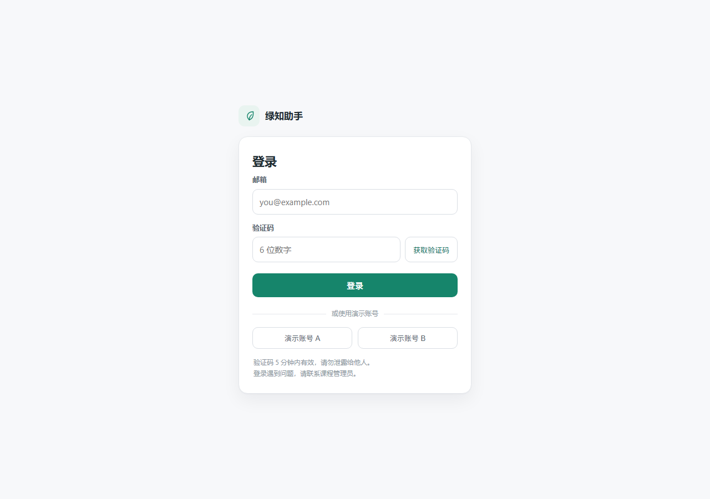
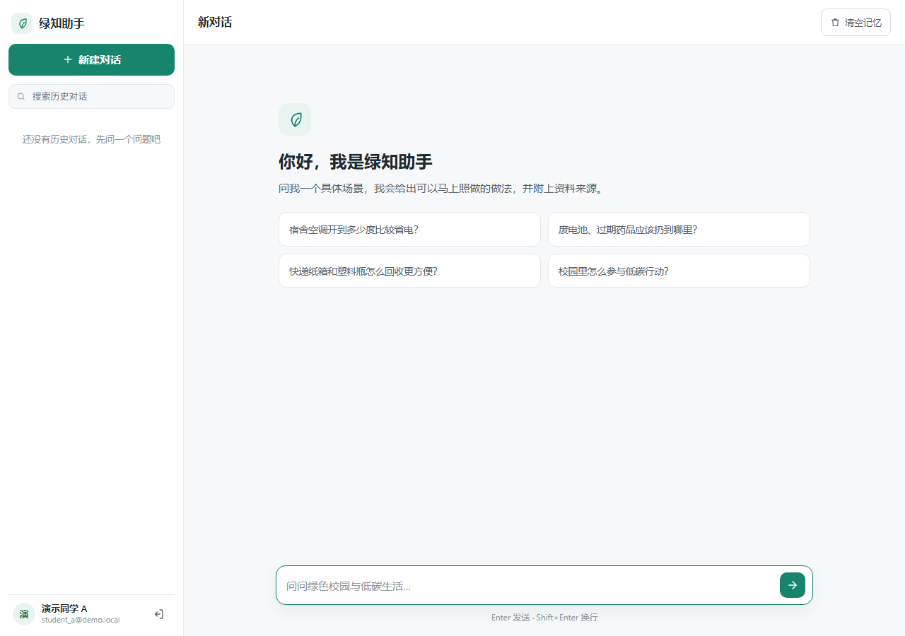
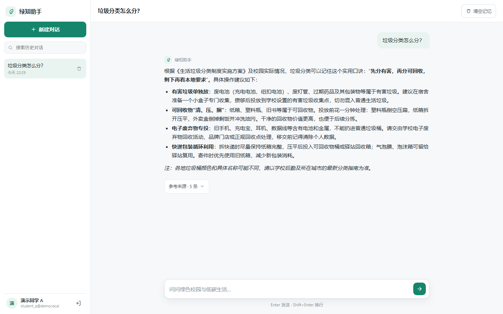
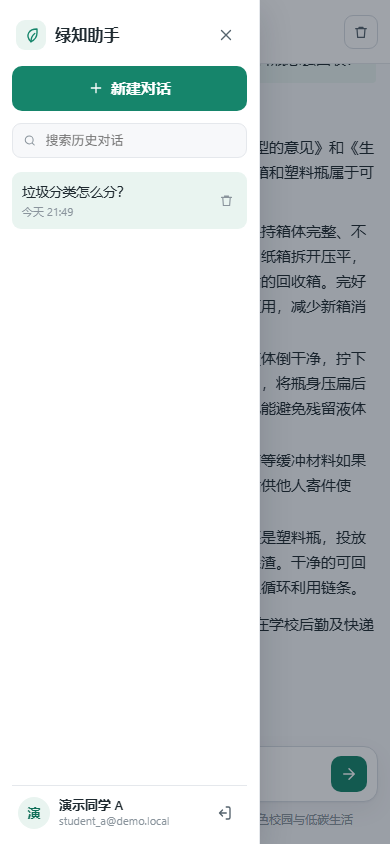

# 绿知助手 · 绿色校园与低碳生活知识问答

面向大学校园的 RAG 问答项目：用 FastAPI + LangChain Agent + FAISS + SQLite/Redis 搭建，
前端是一个可直接使用的中文聊天工作区。知识库主题为**绿色校园与低碳生活**，内容以
节能用电、垃圾分类、节约用水、绿色出行、减少一次性用品、校园生态保护、资源循环利用、
个人低碳行动八个方向为主。

本项目由原有“法律问答”演示项目改造而来：保留了 FastAPI + LangChain Agent + FAISS + SSE
的技术路线，重做了知识库、身份与会话持久化、短期记忆、接口和前端界面。

---

## 1. 选题范围与主要功能

**选题**：绿色校园与低碳生活知识问答（回答面向大学生日常场景，客观、具体、可执行）。

**已实现功能**：

| 模块 | 功能 |
| --- | --- |
| 知识库 | 25 条结构化资料，8 个子主题，每条带标题、分类、正文、来源名称、来源链接、发布日期、整理日期 |
| 检索 | FAISS 向量索引（DashScope Embedding），分块保留来源元数据，检索结果带标题与来源 |
| 问答 | LangChain Agent 调用知识库检索工具，基于资料回答；资料不足时明确说明，不编造政策与数字 |
| 登录 | 邮箱验证码登录（SMTP + Redis）；另有可关闭的演示账号登录；登录态为服务端会话令牌（HttpOnly Cookie / Bearer） |
| 历史会话 | 新建、列表（支持搜索）、查看、重命名、删除；会话与消息持久化到 SQLite |
| 用户隔离 | 每个接口都在服务端按用户过滤，A 无法读取或删除 B 的会话 |
| 短期记忆 | 每次提问携带当前会话最近 5 轮完整对话，超长自动截断；界面上可“清空记忆”（历史消息保留） |
| 流式输出 | SSE 输出 `meta / answer / sources / done / error` 事件；断开或模型异常时保存为“未完成”，不当作完整答案 |
| 前端 | “绿知助手”聊天工作区：会话侧栏、搜索、来源折叠区、停止生成、移动端抽屉、错误与空状态 |
| 测试与脚本 | 52 个 pytest 用例（全部 mock 模型/邮件）、索引构建脚本、检索验证脚本、端到端冒烟脚本 |

### 界面预览

| 登录页 | 聊天工作区（空态） |
| --- | --- |
|  |  |

| 回答与来源区 | 窄屏抽屉 |
| --- | --- |
|  |  |

> 截图中的账号为演示账号 `student_a@demo.local`，不包含任何真实凭据。

---

## 2. 系统结构

```
浏览器（static/chat.html + assets/app.js）
   │  ① 登录：GET /api/auth/vcode、POST /api/auth/login（或 /api/auth/demo-login）
   │     服务端校验验证码（Redis）→ 创建用户 → 写入 sessions 表 → 下发 HttpOnly Cookie
   │
   │  ② 提问：POST /api/chat/stream  {query, conversation_id}
   ▼
FastAPI（main.py → api_router/*）
   │  依赖 get_current_user：Cookie/Bearer token → sessions 表 → user
   ▼
ChatService（service/chat_service.py）
   │  a. 校验会话归属（conversations.user_id）
   │  b. 读取最近 5 轮记忆（service/memory.py，受 memory_cleared_at 限制）
   │  c. 保存用户消息（SQLite messages）
   │  d. 调用 AgentEngine
   ▼
AgentEngine（service/agent_engine.py）
   │  LangChain create_agent + 工具 vector_retrieve
   ▼
vector_retrieve（tools/vector_retrieve_tools.py）
   │  → VectorRetriever（retriever/vector_retriever.py，缓存加载 FAISS）
   │  → DashScope Embedding（models/llm.py，向量模型）
   │  → FAISS 索引（faiss-index/default，由 indexer/ 构建）
   │  工具返回 JSON：标题 / 分类 / 来源名称 / 来源链接 / 正文片段
   ▼
通义千问（ChatOpenAI 兼容接口，流式返回）
   │  增量文本 → SSE answer；工具 JSON → SSE sources
   ▼
ChatService 结束处理
   │  完整结束：assistant 消息 status=complete，进入后续短期记忆
   │  断开/异常：已生成部分 status=interrupted
   ▼
SQLite（data/app.db：users / sessions / conversations / messages）
```

SSE 事件结构见第 8 节；数据保存在本机文件与 Redis 中的位置见第 5 节。

---

## 3. 目录树

```
agentic_rag/
├── main.py                      # FastAPI 入口：路由、静态页、错误格式、启动初始化
├── requirements.txt             # 依赖清单（Python 3.12）
├── .env.example                 # 环境变量模板（仅占位符）
├── .gitignore                   # 忽略 .env / data / faiss-index 等
├── README.md
├── agent/
│   └── chat_agent.py            # 系统提示词 + Agent 构建（注入短期记忆）
├── api_router/
│   ├── auth_router.py           # 验证码、登录、演示登录、me、退出
│   ├── chat_router.py           # POST /chat/stream、GET /chat/ask、/chat/health
│   ├── conversation_router.py   # 会话 CRUD + 清空记忆
│   ├── deps.py                  # Cookie/Bearer → 当前用户（401）
│   └── response.py              # 统一 {code,msg,data}
├── datasets/
│   ├── green_campus_low_carbon.md   # 新知识库（25 条，带来源元数据）
│   └── legal_qa_pairs_42.md         # 旧法律问答语料（保留，不再用于索引）
├── faiss-index/
│   └── default/                 # index.faiss / index.pkl / manifest.json（构建产物，不入库）
├── indexer/
│   ├── document_loader.py       # 解析 --- 字段块，校验必填来源
│   ├── document_splitter.py     # 600 字切块，保留元数据并加标题前缀
│   └── vector_indexer.py        # 建库 + 写 manifest（记录数据集哈希、chunk 数）
├── retriever/
│   └── vector_retriever.py      # FAISS 缓存加载、检索、索引就绪判断
├── tools/
│   └── vector_retrieve_tools.py # @tool，返回带来源的 JSON
├── models/
│   └── llm.py                   # 延迟创建 LLM / Embedding
├── service/
│   ├── auth_service.py          # 用户、会话令牌、验证码登录、演示登录
│   ├── chat_service.py          # SSE 编排、落库、断开/异常处理
│   ├── agent_engine.py          # Agent 流 → 统一事件（answer/sources/error）
│   ├── conversation_service.py  # 会话/消息业务 + 归属校验
│   ├── memory.py                # 最近 5 轮、截断、格式化
│   ├── storage.py               # SQLite 仓储层（建表、用户、会话、消息）
│   ├── redis_service.py         # 验证码、发送冷却
│   ├── email_service.py         # SMTP 发信（保留原实现）
│   ├── runtime.py               # 运行期服务容器（测试可注入临时库）
│   └── sse.py                   # SSE 编码与解析
├── scripts/
│   ├── build_index.py           # 重建索引 + 分类统计 + 检索自检
│   ├── check_retrieval.py       # 不起服务验证检索
│   ├── check_sources.py         # 校验所有来源链接可访问且不是 404 页面
│   └── smoke_test.py            # 起服务后的端到端冒烟检查
├── static/
│   ├── chat.html                # 新聊天页（无 Vue/Element 依赖）
│   ├── login.html               # 新登录页
│   ├── assets/app.css           # 页面样式（浅色主题、响应式）
│   ├── assets/app.js            # 页面逻辑（会话、SSE、Markdown、状态）
│   ├── lib/                     # 本地静态依赖（marked 等）
│   └── legacy/                  # 改造前的旧页面备份（chat_v1/login_v1）
└── tests/
    ├── conftest.py              # 临时 SQLite、假 Agent 引擎、假 Redis
    ├── test_dataset_and_index.py
    ├── test_auth.py
    ├── test_conversations.py
    ├── test_memory.py
    ├── test_sse.py
    ├── test_agent_engine.py
    ├── test_prompt.py
    └── test_frontend_contract.py
```

**本次新增**：`datasets/green_campus_low_carbon.md`、`service/{storage,auth_service,memory,conversation_service,agent_engine,sse,runtime}.py`、
`api_router/{deps,conversation_router}.py`、`scripts/*`、`tests/*`、`static/login.html`、`static/chat.html`、
`static/assets/*`、`.env.example`、`requirements.txt`、`.gitignore`、`README.md`。

**本次修改**：`main.py`、`api_router/{auth_router,chat_router,response}.py`、`agent/chat_agent.py`、
`models/llm.py`、`tools/vector_retrieve_tools.py`、`retriever/vector_retriever.py`、
`service/{chat_service,redis_service}.py`、`indexer/{document_loader,document_splitter,vector_indexer}.py`、`utils/config.py`。

**未改动**：`service/email_service.py`（仅保留原实现）、`static/lib/*`、旧语料和旧页面备份。

---

## 4. Windows PowerShell 环境搭建

要求：**Python 3.12**（本项目在 3.12.15 上验证；3.14 也可导入，但依赖版本以 requirements 为准）。
另需可用的 Redis（见第 5 节）。

```powershell
cd D:\shixun\agentic_rag

# 1) 创建并激活虚拟环境
py -3.12 -m venv .venv
.\.venv\Scripts\Activate.ps1
# 如提示“禁止运行脚本”，先执行：
# Set-ExecutionPolicy -Scope Process -ExecutionPolicy Bypass

# 2) 安装依赖
python -m pip install --upgrade pip
python -m pip install -r requirements.txt

# 3) 配置环境变量
Copy-Item .env.example .env
notepad .env
```

`.env` 需要填写：

| 变量 | 说明 |
| --- | --- |
| `QWEN_API_KEY` | 通义千问 API Key（DashScope） |
| `QWEN_MODEL_NAME` / `QWEN_BASE_URL` | 对话模型名与兼容接口地址 |
| `EMBEDDINGS_MODEL_NAME` | 向量模型名（需与建索引时一致） |
| `SMTP_HOST/PORT/USER/PASSWORD` | 邮箱 SMTP；`SMTP_PASSWORD` 填**授权码**，不是邮箱登录密码 |
| `REDIS_URL` | 默认 `redis://localhost:6379/0` |
| `DEMO_LOGIN_ENABLED` | 本地演示设为 `1`；正式部署设为 `0` |

> 只提交 `.env.example`，不要提交 `.env`；示例文件里全是占位符，不包含真实凭据。

---

## 5. Redis、历史数据与备份

**Redis 的用途**：登录验证码（`code:<email>`，默认 5 分钟）、发送冷却（`vcode:cooldown:<email>`，60 秒）。
**历史会话不依赖 Redis**：即使用户登录时 Redis 短暂不可用，已登录用户的历史仍可读写。

启动与检查（任选其一）：

```powershell
# 本机安装 Redis / Memurai，或 Docker
docker run -d --name rag-redis -p 6379:6379 redis:7
redis-cli ping          # 期望输出 PONG
```

**历史数据位置**：`data/app.db`（SQLite，WAL 模式）。首次启动自动建表，无需手动初始化。
表结构：`users`（用户）、`sessions`（登录态）、`conversations`（会话，含 `memory_cleared_at`）、
`messages`（消息，含 `sources_json` 与 `status`）。

```powershell
# 查看大小
Get-Item .\data\app.db | Select-Object Length,LastWriteTime

# 备份（先停服务，或使用 SQLite 的 .backup）
Copy-Item .\data\app.db .\data\app.backup.db

# 重置全部历史（谨慎：不可恢复）
Remove-Item .\data\app.db -Force
```

若要改用其他位置，在 `.env` 设置 `HISTORY_DB_PATH`（目录必须可写；中文路径可用，见第 9 节）。

---

## 6. 知识库与索引

### 6.1 数据格式

`datasets/green_campus_low_carbon.md` 由若干条记录组成，每条以 `---` 开头，字段固定：

```
---
id: energy-01
title: 教学楼和图书馆的空调应该设多少度
category: 节能用电
source_name: 国务院办公厅
source_url: https://www.gov.cn/zwgk/2007-06/03/content_634614.htm
published_at: 2007-06-01
curated_at: 2026-10-24
---

正文段落……
```

`indexer/document_loader.py` 会校验 `title/category/source_name/source_url`，链接必须是 http(s)，
发布日未知时可写“未注明”。分块时标题、分类与全部来源字段随 metadata 传递，检索结果可回到来源。

### 6.2 资料来源

以下 10 份公开文件构成了知识库的主要依据（整理日期 2026-10-24，链接当时均可访问）：

| 来源 | 文件 | 发布日期 | 链接 |
| --- | --- | --- | --- |
| 国务院办公厅 | 关于严格执行公共建筑空调温度控制标准的通知（国办发〔2007〕42号） | 2007-06-01 | https://www.gov.cn/zwgk/2007-06/03/content_634614.htm |
| 发展改革委、水利部 | 国家节水行动方案（发改环资规〔2019〕695号） | 2019-04-15 | https://www.gov.cn/gongbao/content/2019/content_5419221.htm |
| 国务院办公厅 | 生活垃圾分类制度实施方案（国办发〔2017〕26号） | 2017-03-18 | https://www.gov.cn/gongbao/content/2017/content_5186978.htm |
| 发展改革委、生态环境部 | 关于进一步加强塑料污染治理的意见（发改环资〔2020〕80号） | 2020-01-16 | https://www.gov.cn/zhengce/zhengceku/2020-01/20/content_5470895.htm |
| 交通运输部、发展改革委 | 绿色出行创建行动方案 | 2020-07-24 | https://xxgk.mot.gov.cn/jigou/ysfws/202007/t20200724_3437849.html |
| 国家发展改革委 | “十四五”循环经济发展规划（发改环资〔2021〕969号） | 2021-07-07 | https://www.ndrc.gov.cn/xxgk/zcfb/ghwb/202107/t20210707_1285527.html |
| 生态环境部等五部门 | 公民生态环境行为规范十条（公告附件 PDF） | 2023-06-05 | https://www.mee.gov.cn/xxgk2018/xxgk/xxgk01/202306/W020230605340933724690.pdf |
| 国家发展改革委 | 绿色生活创建行动总体方案（发改环资〔2019〕1696号） | 2019-11-05 | https://zfxxgk.ndrc.gov.cn/web/iteminfo.jsp?id=16572 |
| 国务院办公厅 | 关于加快推进快递包装绿色转型的意见（国办函〔2020〕115号） | 2020-12-14 | https://www.gov.cn/zhengce/zhengceku/2020-12/14/content_5569345.htm |
| 国务院 | 废弃电器电子产品回收处理管理条例（国务院令第551号） | 2009-03-04 | https://www.gov.cn/zhengce/zhengceku/2009-03/04/content_4835.htm |

说明：

- 《公民生态环境行为规范十条》的正文随公告以 PDF 附件发布，语料直接引用该附件；
  公告页面为 https://www.mee.gov.cn/xxgk2018/xxgk/xxgk01/202306/t20230605_1032476.html
- “十四五”循环经济发展规划、“绿色生活创建行动总体方案”的正文同样以附件形式发布，
  表中所列是发改委的通知页；点击页面上的附件可查看全文。
- 所有链接用 `python -m scripts.check_sources` 校验：除了 HTTP 状态码，还会识别被
  重定向到 `/404/` 的伪可用页面。

整理原则：只写来源中明确的政策要求（如空调温度标准、塑料制品禁限时间表），
不把无法核实的统计数字写成结论；正文以行动建议为主，具体分类名称以学校后勤和所在城市指南为准。
若某条链接日后失效，请以来源机构官网检索文件名替换，并同步更新 `published_at` 与 README。

### 6.3 重建索引

```powershell
# 需要 .env 中的 Embedding 配置可用，且能访问模型接口
python -m scripts.build_index
```

脚本输出记录数、分类分布、chunk 数，并用三个示例问题做检索自检；成功后写入
`faiss-index/default/{index.faiss,index.pkl,manifest.json}`。`manifest.json` 记录构建时间、
数据集 SHA-256、chunk 数、向量模型与分类列表，可用于确认“当前索引是不是这份数据”。

### 6.4 确认索引可用

```powershell
python -m scripts.check_retrieval "垃圾分类怎么分"
python -m scripts.check_retrieval        # 使用内置的四个问题
python -m scripts.check_sources          # 检查全部来源链接（含 404 页面识别）
```

`check_sources.py` 不只看 HTTP 状态码，还会检查最终 URL 是否被重定向到 `/404/`、
正文是否过短或出现“页面不存在”等提示，避免把政府站点返回的 404 页面误判为可用链接。

也可以查看接口自检：`http://127.0.0.1:8800/api/chat/health`（返回 `index_ready` 与 manifest）。
索引文件默认不提交到版本库，**克隆项目后必须重新构建**；没有索引时接口会给出明确提示，
不会返回空答案。

---

## 7. 启动、登录与一次问答

```powershell
cd D:\shixun\agentic_rag
.\.venv\Scripts\Activate.ps1
$env:PYTHONUTF8 = "1"
uvicorn main:app --host 127.0.0.1 --port 8800
```

打开：

- 聊天页：<http://127.0.0.1:8800/chat>（未登录会自动跳转登录页）
- 登录页：<http://127.0.0.1:8800/login>
- 接口文档：<http://127.0.0.1:8800/docs>
- 健康检查：<http://127.0.0.1:8800/healthz>

登录方式：

1. **邮箱验证码**：输入邮箱 → 获取验证码 → 登录。需要 SMTP 与 Redis 可用。
2. **演示账号**：登录页的“演示账号 A/B”，无需邮箱，用于本地演示；`DEMO_LOGIN_ENABLED=0` 时隐藏并拒绝。

一次问答：登录进入 `/chat` → 新建对话 → 输入或点击建议问题 → 观察逐字输出 →
展开回答下方“参考来源”查看标题与链接 → 刷新页面，历史仍在左侧列表 →
“清空记忆”只影响之后的上下文，历史消息保留。

命令行冒烟（服务保持运行）：

```powershell
python -m scripts.smoke_test                 # 登录→提问→来源→历史→清空记忆→删除
python -m scripts.smoke_test --skip-chat     # 只检查登录与会话接口
```

### 7.1 临时公网演示（可选）

没有公网服务器时，可以用隧道把本机 8800 端口临时映射出去，适合课堂演示 / 发给同学体验：

```powershell
# 方式一：tunnelmole（随机域名，免费；本次演示使用）
npm install -g tunnelmole
tmole 8800

# 方式二：localhost.run（无需安装，走 SSH；重连会换域名）
ssh -R 80:127.0.0.1:8800 nokey@localhost.run
```

启动后终端会打印一个 `https://xxx.tunnelmole.net` 或 `https://xxx.lhr.life` 地址，直接访问 `/login`。
注意事项：

- 隧道进程退出（关闭终端、休眠、断网）后链接立即失效；localhost.run 重连后域名会变化。
- 公开链接意味着**任何拿到链接的人**都能访问。演示账号默认开启，模型调用会消耗你的额度；
  演示结束请停止隧道，正式部署请设 `DEMO_LOGIN_ENABLED=0`，并在前面加 HTTPS 反向代理。
- 隧道服务商会看到经过的流量，不要把真实密钥、个人隐私放进去；`.env` 只留在本机。
- Windows 上如需局域网直连，可把启动命令改为 `--host 0.0.0.0` 并放行防火墙端口（仅限可信网络）。

---

## 8. API 清单与 SSE 格式

统一响应：`{"code": 200, "msg": "success", "data": ...}`；业务错误使用对应 HTTP 状态码
（401/403/404/429/502），响应体同样为 `{code,msg,data}`。

| 方法 | 路径 | 权限 | 用途 |
| --- | --- | --- | --- |
| GET | `/api/auth/status` | 公开 | 演示登录开关、Redis 状态、知识库标题 |
| GET | `/api/auth/vcode?email=` | 公开（60s 冷却） | 发送邮箱验证码 |
| POST | `/api/auth/login` | 公开 | `{email,vcode}` 登录，写 HttpOnly Cookie，返回 token 与用户 |
| POST | `/api/auth/demo-login` | 公开（可关闭） | `{account:"A"|"B"}` 演示登录 |
| GET | `/api/auth/me` | 登录 | 当前用户信息 |
| POST | `/api/auth/logout` | 登录 | 注销当前会话令牌 |
| POST | `/api/conversations` | 登录 | 新建会话（可为空标题） |
| GET | `/api/conversations?q=` | 登录 | 会话列表（标题或消息内容搜索） |
| GET | `/api/conversations/{id}` | 登录 + 所有者 | 会话详情与全部消息（含来源、状态） |
| PATCH | `/api/conversations/{id}` | 登录 + 所有者 | 重命名 |
| DELETE | `/api/conversations/{id}` | 登录 + 所有者 | 删除会话及消息 |
| POST | `/api/conversations/{id}/memory/clear` | 登录 + 所有者 | 清空记忆（短期上下文；历史保留，返回保留条数） |
| POST | `/api/chat/stream` | 登录 | `{query,conversation_id?}`，SSE 流式回答 |
| GET | `/api/chat/ask?query=&conversation_id=` | 登录 | 同上，兼容 EventSource 的旧调用 |
| GET | `/api/chat/health` | 公开 | 索引就绪、manifest、模型配置自检（不含密钥） |
| GET | `/healthz` | 公开 | 服务存活 |

**SSE 事件**（每个事件只有一行 `data:`，内容为 JSON）：

| 事件 | data | 说明 |
| --- | --- | --- |
| `meta` | `{conversation_id, created, user_message_id, memory_turns}` | 首个事件；`created=true` 表示自动新建了会话 |
| `answer` | `{delta}` | 增量文本，前端按序拼接 |
| `sources` | `{sources:[{title,category,source_name,source_url,published_at}]}` | 可多次，前端去重后展示 |
| `done` | `{conversation_id, message_id, status, content_chars, memory_turns, sources_count}` | 结束；`status` 为 `complete` / `interrupted` / `failed` |
| `error` | `{message, code}` | 出错（`engine_exception`、`conversation_not_found`、`empty_query` 等） |

示例：

```
event: meta
data: {"conversation_id":"conv_xxx","created":true,"user_message_id":"msg_xxx","memory_turns":0}

event: answer
data: {"delta":"可以把空调设在 26℃ 左右。"}

event: sources
data: {"sources":[{"title":"教学楼和图书馆的空调应该设多少度","category":"节能用电","source_name":"国务院办公厅","source_url":"https://www.gov.cn/...","published_at":"2007-06-01"}]}

event: done
data: {"conversation_id":"conv_xxx","message_id":"msg_yyy","status":"complete","content_chars":120,"memory_turns":0,"sources_count":1}
```

行为约定：

- 客户端断开或模型异常时，已生成的部分以 `status=interrupted` 保存，历史中会标注“未完成”，
  且不会进入后续短期记忆；
- `status=complete` 的消息才会被下一次提问当作上下文；
- 空回答不落库，并返回 `error`。

---

## 9. 测试与常见问题

### 9.1 运行测试

```powershell
python -m pip install pytest
python -m pytest -q
```

测试使用临时 SQLite、假 Agent 引擎、假 Redis 和假 SMTP，不需要真实 API Key、不发邮件、不访问外网。
覆盖点：

- 知识库解析、必填来源校验、分块保留元数据、FAISS 建库与检索（假 Embedding）；
- 验证码登录、Cookie/Bearer 鉴权、退出失效、限频、演示开关；
- 会话新建/列表/详情/重命名/删除、搜索、跨用户读写均被拒绝、服务重启后历史仍在；
- 最近 5 轮记忆、单条与总长度截断、清空后上下文清空、会话之间隔离；
- SSE 事件顺序、增量拼接、来源、错误、异常中断落库状态、越权会话、旧 GET 接口；
- 前端契约：新页面不依赖 Vue/Element、不使用 localStorage 存身份、接口路径与后端一致、
  `app.js` 引用的元素 id 全部存在、静态资源存在。

### 9.2 本次交付的实际验证记录

在 `D:\Anaconda3\envs\RAG.env`（Python 3.12.15）下实际执行：

| 命令 | 结果 |
| --- | --- |
| `python -m scripts.build_index` | 25 条记录、8 个分类、25 个 chunk；三个示例问题的检索自检均命中正确条目，写入 `faiss-index/default/manifest.json` |
| `python -m pytest -q` | **52 passed**（约 6 秒，无外网请求） |
| `python -m scripts.smoke_test --base-url http://127.0.0.1:8800` | 登录、提问、来源、历史、清空记忆、删除会话全部通过；真实模型返回 5 条来源、`status=complete`（另一次运行回答 2387 字） |
| `python -m scripts.check_sources` | 9 个来源链接全部通过（含 404 页面识别）；据此修正了生态环境部的一条失效链接，改为官方公告附件 PDF |
| 真实接口复检 | 清空前 `memory_turns=2`，清空后 `memory_turns=0`；用户 B 读取/删除用户 A 的会话均返回 404 |
| 前端检查 | 用 Edge headless 实际打开登录页、桌面聊天页（空态/回答/来源展开/清空记忆弹窗）、390×844 窄屏与抽屉；无横向溢出，无 JS 报错 |

未执行或无法在本机验证的部分：SMTP 真实发信（使用假邮件服务测试）、公网部署与 HTTPS、
长时间多用户压测。

### 9.3 常见错误

| 现象 | 原因与处理 |
| --- | --- |
| 页面提示“验证码服务暂不可用” | Redis 未启动。执行 `redis-cli ping`；或先使用演示账号 |
| 发送验证码返回 502 | SMTP 配置错误。确认 `SMTP_PORT`（SSL 常为 465）、`SMTP_PASSWORD` 是授权码 |
| 启动报 `缺少 QWEN_API_KEY` | 没有 `.env` 或没填 Key。复制 `.env.example` 为 `.env` 并填写 |
| 提问报“知识库索引不存在” | 没建索引或索引目录被删。运行 `python -m scripts.build_index` |
| 检索结果与问题无关 | 索引是旧主题（法律语料）。删掉 `faiss-index/default` 后重建 |
| 模型接口 401/超时 | Key 失效、额度不足或网络不可达；检查 `QWEN_BASE_URL` 与网络 |
| 中文路径/输出乱码（Windows） | 终端执行 `chcp 65001`，并设置 `$env:PYTHONUTF8="1"`；文件统一 UTF-8 |
| 端口被占用 | 换端口：`uvicorn main:app --port 8801`，并同步修改 `scripts/smoke_test.py --base-url` |
| 登录后刷新变成未登录 | Cookie 被清除或过期（默认 7 天）；重新登录；确认访问的是同一 host |
| 历史会话看不到 | 确认登录的是同一账号；SQLite 文件是否被删除；检查 `data/app.db` 权限 |

> 数据重置：删除 `data/app.db` 会清空用户与全部历史；删除 `faiss-index/default` 只影响检索，不影响历史。

---

## 10. 五人分工模板

> 以下 A–E 为占位，请替换为真实姓名；每人都需要写代码与交付物，没有“只写文档/只做汇报”的角色。

| 成员 | 负责目录 | 技术任务 | 交付成果 |
| --- | --- | --- | --- |
| **A** | `datasets/`、`indexer/`、`faiss-index/`、`scripts/build_index.py`、`scripts/check_retrieval.py` | 维护绿色校园知识库与来源元数据；解析、分块、建索引；检索质量验证 | 新主题语料（≥20 条、来源可查）、索引构建流程、检索演示与问题排查记录 |
| **B** | `service/storage.py`、`service/auth_service.py`、`service/conversation_service.py`、`api_router/{auth,conversation}_router.py`、`api_router/deps.py` | 用户与会话令牌、SQLite 持久化、会话/消息接口、用户隔离、清空记忆语义 | 可用的登录与会话 API、越权测试、持久化与重启验证 |
| **C** | `agent/`、`tools/`、`retriever/`、`service/{chat_service,agent_engine,memory}.py` | Retrieval 工具返回来源、Agent 提示词与流式编排、最近 5 轮记忆、断开与异常处理 | 检索增强回答、SSE 事件、记忆截断与清空测试、错误处理 |
| **D** | `static/chat.html`、`static/login.html`、`static/assets/` | 新聊天工作区、登录页、会话切换/新建/删除、SSE 渲染、来源区、响应式与无障碍 | 可操作的界面、移动端适配、前端契约测试、交互自查清单 |
| **E** | `tests/`、`main.py`、`.env.example`、`requirements.txt`、`README.md`、`scripts/smoke_test.py` | 集成与质量：接口测试、启动检查脚本、配置与文档、全流程联调 | 可重复运行的测试集与冒烟脚本、环境搭建文档、联调记录与问题清单 |

协作约定：接口改动先改 README 第 8 节与测试，再改前后端；提交前运行 `python -m pytest -q`
和 `python -m scripts.smoke_test`。

---

## 11. 已知限制与说明

1. 知识库为课程演示规模（25 条、8 个子主题），不是覆盖全部政策条文的法规库；回答中涉及具体
   分类名称、处罚或地方政策时，以学校后勤和所在地官方指南为准。
2. 演示账号（默认开启）只用于本地体验；公开部署前请设置 `DEMO_LOGIN_ENABLED=0`，并收紧 CORS。
3. 历史列表一次返回全部匹配会话，未做分页；会话量很大时需要加分页。
4. 未实现多设备会话共享、消息编辑、附件上传；这些不在本次改造范围内。
5. 旧的法律问答语料与旧页面备份仍保留在 `datasets/legal_qa_pairs_42.md`、
   `static/legacy/`、`static/*_v2.html`、`static/*.bak`，不再被新界面引用。
6. 本目录改造前不是 git 仓库，因此没有执行 `git init`、也没有提交记录；如需版本管理，
   可在此目录执行 `git init` 后按 `.gitignore` 提交。
7. 检索依赖 DashScope Embedding，建索引和在线检索必须使用同一向量模型；替换模型后需重建索引。
